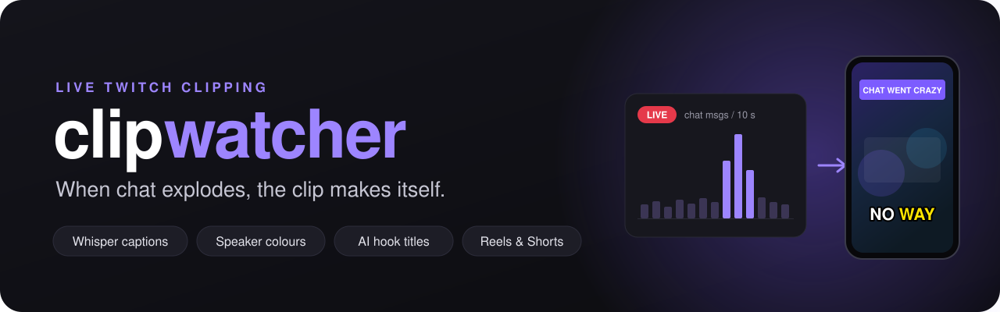
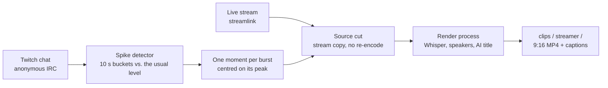

<p align="center">
  
</p>

<p align="center">
  <a href="https://github.com/YaShDsOnI/clipwatcher/actions/workflows/ci.yml"></a>
  
  
  <a href="https://pypi.org/project/clipwatcher/"></a>
  <a href="https://github.com/YaShDsOnI/clipwatcher/releases"></a>
  <a href="LICENSE"></a>
</p>

<p align="center">
  <b>Auto-clip Twitch streams while they're live.</b><br>
  When chat explodes, the moment becomes a captioned vertical clip for Instagram Reels and YouTube Shorts.
</p>

<p align="center">
  <a href="#quick-start">Quick start</a> ·
  <a href="#features">Features</a> ·
  <a href="#how-it-works">How it works</a> ·
  <a href="#editor">Editor</a> ·
  <a href="#dashboard">Dashboard</a> ·
  <a href="#configuration">Configuration</a> ·
  <a href="SETUP%20GUIDE.txt">Setup guide</a>
</p>

---

In the spirit of [SupoClip](https://github.com/FujiwaraChoki/supoclip) and OpusClip, but built for streams that are **live right now**. Chat decides what's worth clipping: every clip gets word-synced captions, a colour per speaker, a hook title and a hype score. It runs on your own PC, next to other heavy software such as Docker AI containers, without eating your RAM.

## Features

<table>
  <tr>
    <td width="50%" valign="top">
      <b>Clips itself from chat</b><br>
      Reads Twitch chat, spots bursts far above the usual level and clips the moment, centred on its peak. Spam and bots can't fake a spike.
    </td>
    <td width="50%" valign="top">
      <b>Word-synced captions</b><br>
      Whisper captions in four styles (karaoke, boxed, clean, pop), with a different colour for each speaker.
    </td>
  </tr>
  <tr>
    <td valign="top">
      <b>Hook titles and scores</b><br>
      A hype score from chat, plus hook titles, virality scores and post captions from chat (free) or an AI: Gemini, Groq, OpenRouter, Claude or OpenAI.
    </td>
    <td valign="top">
      <b>Vertical layouts</b><br>
      Blurred background, centre crop, or the classic streamer split with a facecam box you draw on a live frame.
    </td>
  </tr>
  <tr>
    <td valign="top">
      <b>Light on RAM</b><br>
      AI models load only while a clip is being made (~600 MB for ~20 s), then the memory goes straight back. One clip at a time, at low priority.
    </td>
    <td valign="top">
      <b>Built-in video editor</b><br>
      Cut, split, speed up, add text, music and zoom punch-ins, reframe for Reels, Shorts or feed, then export a new file. The original is never changed.
    </td>
  </tr>
</table>

## Quick start

**Windows, no terminal:** download `clip-watcher.zip` from [Releases](https://github.com/YaShDsOnI/clipwatcher/releases), unzip it and double-click **`Start clip-watcher.bat`**. [`SETUP GUIDE.txt`](SETUP%20GUIDE.txt) walks through it step by step.

**With pip** (Python 3.12–3.14):

```bash
pip install "clipwatcher[all]"     # or just  pip install clipwatcher  and add parts later from the Setup tab
winget install Gyan.FFmpeg         # or: choco / apt / brew install ffmpeg
clipwatcher                        # opens the dashboard at http://localhost:8765
```

Installed this way, your clips and settings live in `~/clip-watcher` (see [Data folder](#data-folder)).

**From source:**

```bash
git clone https://github.com/YaShDsOnI/clipwatcher.git && cd clipwatcher
pip install -e ".[all]"            # all optional parts (or just: pip install -e .)
winget install Gyan.FFmpeg         # or: choco / apt / brew install ffmpeg
clip-watcher                       # opens the dashboard at http://localhost:8765
```

No install at all also works from the project folder: `python -m clipwatcher` (or `./dashboard.sh`).

## How it works



| Part | What it does | RAM |
|---|---|---|
| **Recorder** (`clip-watcher watch`), one per streamer | Chat, spike detection, recording; cuts a small source per clip | ~30 MB + ~70 MB for streamlink |
| **AI step** (`clip-watcher render`), one clip at a time | Whisper captions, speaker detection, title, final render | ~600 MB for ~20 s per clip, then **0** |
| **Dashboard** (`clip-watcher dashboard`) | The web page | ~35 MB |

The AI models are never kept loaded. Each clip starts its own render process, which loads the models, makes the clip and exits, and the OS gets the memory back immediately. A machine-wide lock means only one clip is ever processed at once, however many streamers you record. The AI step also runs at **below-normal priority** and uses at most 4 CPU threads (`--threads`), so Docker and your games keep the CPU. Measured on the author's PC: the previous version used ~750 MB per streamer, all the time.

<details>
<summary><b>Step by step: from chat burst to finished clip</b></summary>

1. **Recording:** streamlink records the stream to `rec/`. If the channel is offline, it waits for the stream to start; streamlink 7+ skips ads automatically. When a stream ends, it waits for the streamer to come back and starts a new recording (`--once` stops instead).
2. **Chat:** chat is read anonymously over IRC (`irc.chat.twitch.tv:6667`, `NICK justinfan12345`, no token), keeping who said what for hook titles.
3. **Spike detection:** messages are counted in 10 s buckets. A bucket is a spike when it has at least `--ratio` (1.7) × the usual level **and** at least `--min` (10) messages. The usual level is the lower of the median of the last 3 minutes and of the last 10 minutes, so chat that stays wild for several minutes keeps getting clipped instead of becoming the new normal. Chat history is kept for 2 minutes across restarts, so changing settings doesn't start a new 3-minute warm-up.
   - **Spam and bots don't count:** each chatter counts at most `--per-user` (2) messages per bucket, and known bots (Nightbot, StreamElements, …) never count.
   - **One moment, one clip:** spike buckets close together are merged into one moment, and the clip is centred on its peak. There's at least `--gap` (30) seconds between clips, and optionally at most `--max-per-hour` clips per hour. "Clip now" ignores both limits.
4. **Source cut:** each clip keeps a 1-minute source in `clips/.sources/`: the clip plus 15 s each side. It's stream-copied (no re-encode), so it costs almost no CPU, and it's what makes later re-editing possible.
5. **AI step:**
   - **Captions:** the audio is loudness-levelled so quiet voices count too, then Whisper writes word-timed captions (`.srt` alongside).
   - **Speakers:** sherpa-onnx (pyannote segmentation 3.0 + WeSpeaker, downloaded into `models/` from Setup) works out who said each phrase.
   - **Render:** ffmpeg renders the 1080×1920 clip with everything burned in, into `clips/<streamer>/`.
6. **Recordings:** by default the full recording is **deleted** once its clips are made, because every clip has its own source. Use `--keep-recordings` to keep them.

</details>

## Where your clips are

Finished clips are saved in **`clips/<streamer>/`**, one folder per streamer, so you can copy them straight from there:

```
clips/
  lacy/
    lacy_20261118-164340_81msgs.mp4      the clip, ready to post
    lacy_20261118-164340_81msgs.srt      its captions
  theburntpeanut/
    ...
  .sources/  .meta/  .thumbs/  .work/    clip-watcher's own working files
```

Clips made by older versions directly in `clips/` are moved into their streamer's folder automatically.

## Dashboard

```bash
clip-watcher                                # opens http://localhost:8765
clip-watcher dashboard --port 9000 --no-browser
```

A local web page, reachable only from this computer.

**Streamers**
- **Adding:** add a streamer by name or twitch.tv link, choose settings, then start or stop recording.
- **Card:** live status, a chat-activity graph for the last 6 minutes (clipped moments highlighted), clip and spike counts, and the log.
- **Clip now:** clips the last 20 seconds and the next 10 right away, for a moment the detector missed.
- **Stop:** finishes that streamer's queued clips first.
- **Settings:** can be changed while recording; the streamer restarts in a few seconds and keeps its chat history, so there's no warm-up again. Settings cover sensitivity, **gap between clips** and **max clips per hour**, layout (including **streamer split** with a facecam box you draw on a live frame), caption style, hook title mode, speaker colours, and whether to keep full recordings.

**Clips**
- **Gallery:** every clip with thumbnail, hook title, hype/virality score and a NEW badge. Clips still being made show a spinner.
- **Find:** search by what was said or by title, filter by streamer, and sort **newest first** or **best first** (by virality/hype score).
- **Player:** plays the clip with its transcript (click a line to jump there). It shows the scores, the folder the clip is saved in and, with an AI set up, a suggested post caption with hashtags and a Copy button.
- **Edit:** opens the clip in the [editor](#editor). Edited versions are listed under the clip, ready to watch, download or delete.
- **New title:** asks the AI (or chat) for a new hook title. Only the title shown in the dashboard changes.
- **Delete:** click twice. It removes the clip, its captions, source and metadata.

**Setup:** which optional parts are installed, the caption model, and **Storage**: space used per streamer and how long to keep things (see [Disk space](#disk-space)).

The header shows how many streamers are recording, whether the AI step is working and free disk space. The streamer list is saved in `streamers.json` (see [`streamers.example.json`](streamers.example.json)); each streamer's output goes to `logs/<channel>.log`. Ctrl+C in the dashboard's terminal stops every streamer cleanly first.

## Editor

Click **Edit** on any clip for a Clipchamp-style editor. **The original clip is never changed:** every export is a new MP4 in `clips/<streamer>/edits/`.

- **Timeline** with thumbnails and the sound's waveform; zoom with the slider or Ctrl + mouse wheel.
- **Cut:** drag a part's edges to trim it, **split** at the playhead (S), select a part and **delete** it (Del) to cut out the middle.
- **Move parts:** drag a part along the timeline to leave **blank space** before it (black and silent; music and text keep playing), or past another part to **swap** them. Click a blank space to set its length or delete it.
- **Speed** per part: 0.5× to 2×, video and sound together.
- **Zoom punch-in** per part: zooms in on a moment and holds it, the classic reaction effect.
- **Text:** presets (hook title band, big reaction, subtitle box, label); drag text on the video; size, colours, fade or pop-in; set when it shows on the text track.
- **Captions** that follow your cuts and speed changes, in any of the 4 styles (when the clip's 1-minute source still exists).
- **Frame:** 9:16 (Reels / Shorts), 4:5 (Instagram feed) or 1:1; blurred / crop / facecam-split layouts from the source, or fill / whole-video-with-blur from the finished clip; zoom & pan.
- **Audio:** click the **Sound** track to set the video's own volume (M mutes it) and fades; **drag & drop music or sounds** onto the editor or upload them (MP3, M4A, WAV, OGG up to 30 MB, kept in `music/`), place them on the music track, trim, set volume and fades.
- **Undo / redo** (Ctrl+Z / Ctrl+Shift+Z) and keyboard shortcuts; your edit is saved as you go and comes back when you reopen it.
- **Export** runs in the background at low priority with a progress bar, then **Download**.

What the edit is cut from:

| | 1-minute source | 30-second clip |
|---|---|---|
| Available | for `KEEP_SOURCES_DAYS` (default 7) | always |
| Cut, speed, punch-ins, text, music, size | ✓ | ✓ |
| Blurred / crop / facecam-split layouts | ✓ | fill or whole-video-with-blur |
| Captions re-timed to your cuts, any style | ✓ | already in the picture |
| Go beyond the original 30 s | ✓ (15 s each side) | |

## Command line

```bash
clip-watcher watch <twitch_channel> [more channels...] [options]

clip-watcher watch nickmercs
clip-watcher watch nickmercs lirik --quality 720p --template boxed
clip-watcher watch jynxzi --layout split --facecam 0,0.52,0.31,0.48
clip-watcher watch lacy --ratio 1.6 --max-per-hour 15
```

`./watch.sh` does the same without installing.

> [!TIP]
> **Tuning `--ratio` (default 1.7).** Busy chats are always busy and rarely double: a chat that runs at 100–200 messages per 10 s often only reaches 1.6–1.8× normal at a hype moment, which is why the default is 1.7. On a small channel, if ordinary chatter gets clipped, raise it to about `2.5`. If you get too many clips, raise `--gap` or set `--max-per-hour`.

## Configuration

### Layouts (`--layout`)
- **`blur`** (default): the whole frame in the middle over a blurred, darkened copy.
- **`crop`:** a center crop to 9:16.
- **`split`:** the classic streamer Short. The facecam (`--facecam x,y,w,h` as fractions of the frame, or drawn in the dashboard) fills the top, and the gameplay fills the bottom.

### Caption styles (`--template`)
- **`karaoke`:** bold uppercase, with the spoken word in yellow.
- **`boxed`:** the same words on a dark band.
- **`clean`:** sentence case, no highlight.
- **`pop`:** one big word at a time with a pop-in animation.

In every style, each speaker gets their own colour. The main voice of the clip is white, then cyan, pink, violet and orange.

### Hook titles and scores (`--title`)
- **`auto`** (default): an AI writes the title if one is set up (see below); otherwise it comes from chat.
- **`chat`:** the title always comes from chat. It's free, uses no RAM and needs no account: it's based on what chat spammed during the spike, e.g. "CHAT COULDN'T STOP LAUGHING", "HUGE W" or a quote of the top phrase.
- **`off`:** no title.

By default the title is **not** put into the video: the clip has only the video and its captions, and the title is shown in the dashboard (gallery, player, suggested post). Tick **Show the hook title in the video** in the settings (or use `--title-in-video`) to burn it into the first 3 seconds as well. Every clip also gets a **chat hype score** (0–100) from how far chat jumped above its usual level.

### AI providers (optional, several free)

With an AI set up, it writes the hook title, scores the clip 0–10 for hook, engagement, value and shareability (a combined virality score, like SupoClip's), and suggests a post caption with hashtags. The AI runs in the cloud, so it uses **no local RAM**. Recording, captions, speakers and rendering never need a key.

| Provider | Key from | Default model | Cost |
|---|---|---|---|
| **Gemini** | [aistudio.google.com/apikey](https://aistudio.google.com/apikey) | `gemini-3.5-flash-lite` | free tier |
| **Groq** | [console.groq.com/keys](https://console.groq.com/keys) | `openai/gpt-oss-20b` | free tier |
| **OpenRouter** | [openrouter.ai/keys](https://openrouter.ai/keys) | `openrouter/free` (picks a free model) | free: 50 requests/day |
| **Claude** | [console.anthropic.com](https://console.anthropic.com/settings/keys) | `claude-opus-5-5` (`claude-haiku-5-5` is much cheaper) | ~1 cent/clip; needs `pip install "anthropic>=2.0"` |
| **OpenAI** | [platform.openai.com/api-keys](https://platform.openai.com/api-keys) | `gpt-6-luna` | paid |
| **Other** | any OpenAI-compatible API (DeepSeek, Mistral, Together, a local server…) | you choose | depends |

The easiest way to set one up is the dashboard's **AI** tab: pick a provider, paste the key, optionally change the model, and press **Save & test**. It sends one small real request and shows a sample title, or the reason it failed (wrong key, unknown model, free quota used up). New clips use the setting immediately. Consumer subscriptions (ChatGPT Plus, Claude Pro, Gemini Advanced) don't include API keys; the free API keys above work.

<details>
<summary><b>Editing <code>.env</code> by hand, and how the providers are called</b></summary>

The settings live in `.env` in the data folder:

```
AI_PROVIDER=gemini          # auto (first provider with a key) | gemini | groq | openrouter | claude | openai | custom | chat
GEMINI_API_KEY=...          # or GROQ_API_KEY / OPENROUTER_API_KEY / ANTHROPIC_API_KEY / OPENAI_API_KEY / CUSTOM_API_KEY
AI_MODEL=gemini-4-hydrogen  # optional: another model of the chosen provider
AI_BASE_URL=https://...     # only for custom
```

No provider code hard-codes which model supports which feature, so a new model works the day it's released. Claude goes through Anthropic's official SDK: each clip first asks for structured JSON at low effort with a server-side fallback in case the model declines, and if a model doesn't accept part of that request, it steps down to a plainer request and remembers what worked (in `run/`). The other providers use the standard OpenAI chat-completions format over HTTPS the same way, so nothing extra needs installing. If the AI fails (bad key, quota, network), the clip still gets a title from chat.

</details>

### Disk space

In the dashboard's **Setup → Storage** (saved in `.env`):

| Setting | Default | |
|---|---|---|
| `KEEP_SOURCES_DAYS` | 7 | delete a clip's 1-minute source after this many days. The clip stays, and the editor then works from the finished clip. `0` = keep forever |
| `KEEP_CLIPS_DAYS` | 0 | delete whole clips after this many days. `0` = keep forever |

Cleanup runs when the dashboard starts and every hour after that, and never touches a clip that is still being made. When the disk has less than 3 GB free, new clips are skipped (and the dashboard says so) instead of filling the disk.

### All command-line options

<details>
<summary><b>Show the full table</b></summary>

| option | default | |
|---|---|---|
| `--min N` | 10 | minimum messages per 10 s bucket to count as a spike |
| `--ratio R` | 1.7 | spike multiple of the rolling median |
| `--gap S` | 30 | minimum seconds between the end of one clip and the start of the next |
| `--max-per-hour N` | 0 | at most N automatic clips per streamer per hour (0 = no limit) |
| `--per-user N` | 2 | each chatter counts at most N messages per 10 s bucket (0 = no limit); bots never count |
| `--quality Q` | best | streamlink quality (`480p`, `720p`, `1080p60`, ...); `720p` tries 720p60, then 720p30, then best |
| `--layout L` | blur | `blur`, `crop` or `split` (facecam on top) |
| `--facecam x,y,w,h` | | facecam box for `split`, as fractions of the frame |
| `--template T` | karaoke | caption style: `karaoke`, `boxed`, `clean`, `pop` |
| `--title M` | auto | hook title: `auto` (the AI provider if set up, else chat), `chat`, `off` |
| `--title-in-video` | | also burn the hook title into the first 3 s (default: only shown in the dashboard) |
| `--no-captions` | | don't burn captions into the video; the `.srt` is still written |
| `--caption-words N` | 4 | maximum words shown at a time |
| `--no-speakers` | | one caption colour for everyone |
| `--speaker-threshold T` | 0.3 | lower splits voices into more speakers, higher merges more |
| `--keep-recordings` | | keep full recordings (default: delete once clipped) |
| `--threads N` | 2–4 | CPU threads the AI step may use |
| `--model M` | from Setup | caption (Whisper) model (`tiny`, `base`, `small` …; bigger = more RAM). Default: the one chosen in Setup, else `base` |
| `--language L` | auto | spoken language, e.g. `en` |
| `--offset S` | 0 | shift every clip by S seconds if chat reactions and video don't line up |
| `--once` | | stop a channel when its stream ends, instead of waiting to re-record it |
| `--stop-file PATH` | | stop cleanly as soon as this file exists (used by the dashboard) |
| `--dry-run` | | watch chat and print spikes only; good for tuning `--min` on a channel |

Whisper tries the GPU first. If the CUDA libraries are missing, it switches to the CPU and remembers that in `run/whisper-cpu-only`; delete that file after installing CUDA to try the GPU again.

Re-render a clip from the command line: `clip-watcher render clips/.meta/<clip>.json` (`--retitle` for a new title, `--retranscribe` to redo captions).

</details>

## Install and optional parts

clip-watcher never downloads or installs anything on its own. Everything beyond the two basics is **optional**: a missing part just switches its feature off, and the clip is still made.

| Part | Needed? | For | Size | pip extra |
|---|---|---|---|---|
| ffmpeg | yes | cutting and rendering clips | ~200 MB | (not on pip) |
| streamlink | yes | recording the stream | ~10 MB | always installed |
| faster-whisper + a Whisper model (tiny / base / small) | optional | captions | ~60 MB + 75 / 145 / 485 MB | `captions` |
| sherpa-onnx + speaker models | optional | a caption colour per speaker | ~30 MB + ~32 MB | `speakers` |
| anthropic | optional | only for Claude titles | ~5 MB | `claude` |

`pip install -e ".[all]"` installs all the Python packages; models are still only downloaded from Setup.

> [!NOTE]
> **Python 3.12–3.14, 64-bit** (3.14 recommended). Python 3.15 is too new for faster-whisper: its onnxruntime dependency has no 3.15 build yet, so the captions install fails. `Start clip-watcher.bat` picks 3.14/3.13/3.12 automatically when several Pythons are installed.

**Optional parts.** Pick either way; both ask before every download:

- **Dashboard → Setup tab:** lists every part as installed or not, with its size and what it's for. Click **Download** / **Install**, then **Click again to confirm**. You also choose the caption model there: `tiny` uses the least RAM, `base` is the default, and `small` gives the best captions.
- **Terminal:** `clip-watcher setup` (or `python -m clipwatcher setup`) lists the parts and asks y/N for each one. Name parts to fetch just those, e.g. `clip-watcher setup whisper-tiny speaker-models`.

If a clip was made while its caption model was missing, download the model, then re-render it from the command line: `clip-watcher render clips/.meta/<clip>.json --retranscribe`.

### Data folder

Clips, recordings, models, logs, `.env` and `streamers.json` live in the **data folder**: the project folder when you run from a download or a git checkout, `~/clip-watcher` when installed as a regular pip package, or anywhere you like with `CLIP_WATCHER_HOME=/path/to/folder`.

## Development

```bash
pip install -e ".[dev]"
pytest                       # unit tests; they use a temporary data folder, never your clips
ruff check .                 # lint
python tools/build_zip.py    # share/clip-watcher.zip for a GitHub Release
```

<details>
<summary><b>Project layout</b></summary>

```
clipwatcher/
  __main__.py     the clip-watcher command (dashboard / watch / render / setup)
  config.py       data folder, clip-folder layout, .env settings, helper processes
  chat.py         Twitch chat reader, spike detector, spike merging, clip limits
  watcher.py      recording (streamlink) and cutting the source for each clip
  clipper.py      the render: Whisper captions, speaker detection, ffmpeg
  captions.py     .srt and burned-in .ass captions, caption styles
  ai.py           hook titles and scores: from chat, or from an AI provider
  components.py   optional parts and the opt-in setup
  editor.py       the video editor: checks an edit, renders it with ffmpeg into a new file
  avatars.py      streamers' Twitch profile pictures for the dashboard
  storage.py      per-streamer folders, retention, disk-space checks
  dashboard.py    the local web server
  web/            the dashboard and editor pages (plain HTML/CSS/JS, no build step)
  fonts/          caption font (Montserrat, SIL OFL)
tests/            pytest suite (no network; the export test is skipped without ffmpeg)
tools/            build_zip.py: builds the Windows download
docs/assets/      banner and social preview image
```

</details>

Contributions are welcome: see [CONTRIBUTING.md](CONTRIBUTING.md) and the issues labelled [good first issue](https://github.com/YaShDsOnI/clipwatcher/issues?q=is%3Aissue+is%3Aopen+label%3A%22good+first+issue%22). Questions and ideas go to [Discussions](https://github.com/YaShDsOnI/clipwatcher/discussions), bugs to [Issues](https://github.com/YaShDsOnI/clipwatcher/issues/new/choose), and security problems to the private [security report](SECURITY.md). What changed in each version is in the [changelog](CHANGELOG.md).

## Responsible use

clip-watcher records other people's live streams. Clips you make are still the streamer's content: get permission before posting clips of a channel that isn't yours, credit the streamer, and follow [Twitch's Terms of Service](https://www.twitch.tv/p/legal/terms-of-service/) and the rules of the platform you post to. Chat messages are stored locally only, to write titles.

## License

[MIT](LICENSE) © Yash Soni. The bundled Montserrat font is under the [SIL Open Font License](clipwatcher/fonts/Montserrat-OFL.txt).
